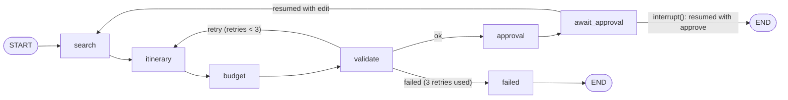
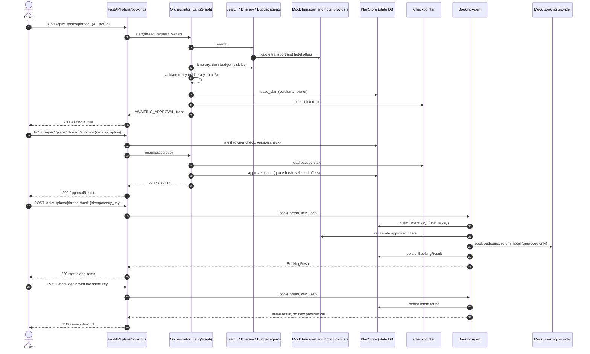
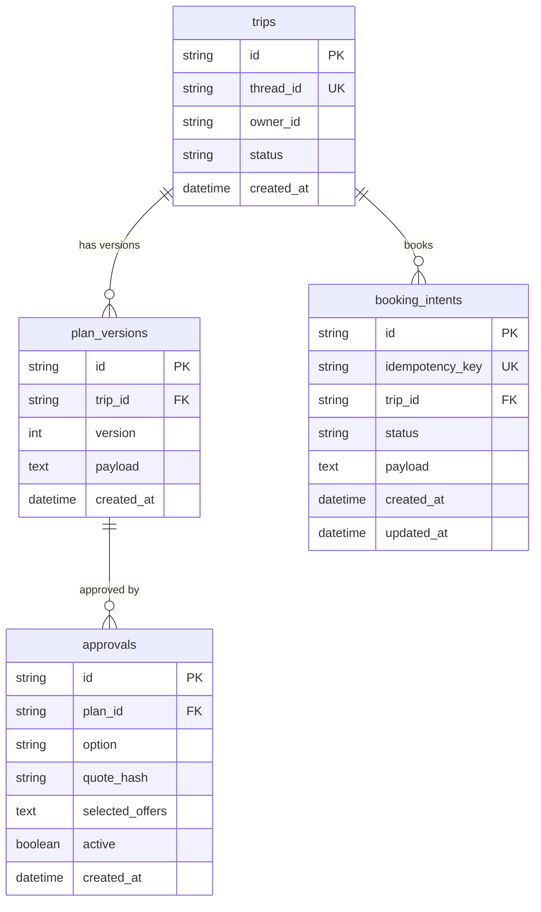

# Architecture

This document describes the system as implemented. Diagrams use Mermaid; GitHub
and most Markdown viewers render them.

## Components

| Part | Where | Role |
| --- | --- | --- |
| FastAPI app | `backend/app/main.py` | Lifespan: validate settings, run migrations, open the checkpointer, build the orchestrator. `GET /health`. |
| Plan API | `backend/app/api/plans.py` | Create/edit, read, approve plans; parse Vietnamese text. |
| Booking API | `backend/app/api/bookings.py` | Book an approved plan (idempotent). |
| Places API | `backend/app/api/places.py` | Read-only POI search over the Hue source. |
| Orchestrator | `backend/app/agents/orchestrator.py` | LangGraph workflow with validation retries and a durable approval interrupt. |
| Checkpointer | `backend/app/agents/checkpoint.py` | SQLite file, Postgres, or in-memory LangGraph saver, chosen by `CHECKPOINT_URL`. |
| State store | `backend/app/db/store.py` | Trips, plan versions, approvals, booking intents (SQLAlchemy). |
| Migrations | `backend/alembic.ini`, `backend/migrations/` | Alembic revisions; `app/db/migrate.py` runs them at startup. |

## The five agents

The project is organised as five agents. Each is deterministic except where noted.

1. **Search Agent**: reads the local Hue POI source (read-only SQLite), ranks candidates with a transparent score, and asks the transport and hotel providers for offers. Only `Huế`, `Thành phố Huế` and `Thừa Thiên Huế` are supported; anything else returns `UNSUPPORTED_DESTINATION`.
2. **Budget Agent**: enumerates compatible transport and hotel offers, prices visits and meals in integer VND, and labels every line `QUOTED`, `ESTIMATED` or `UNKNOWN`. Only known lines are summed; unknown prices are never counted as zero.
3. **Itinerary Agent**: schedules real source `poi_id` values across days with nearest-neighbour Haversine routing, visit durations, meal breaks and buffers. Travel times are straight-line estimates; opening hours are flagged as unverified.
4. **Booking Agent**: books only the offers in the approved option, after revalidating prices. It is idempotent per key and reconciles timeouts. Itinerary POIs are never booked by the system; they are returned as contact items.
5. **Orchestrator Agent**: a LangGraph graph that runs Search, Itinerary and Budget, validates the result, retries up to three times, saves a plan version, and pauses at an approval interrupt. It also owns the Vietnamese rules parser entry point.

All transport and hotel providers are **MOCK** and every such offer carries `source: "MOCK"`.

## Orchestrator graph

Nodes, edges and the retry loop, as built in `Orchestrator._build_graph`.

- `validate` checks itinerary and budget problems. Over-budget is a warning, not a problem; it is reported as a shortfall.
- `approval` saves one plan version (`plan_versions` row) and moves to `await_approval`.
- `await_approval` calls `interrupt()`. The checkpointer persists the paused state, so the process can restart and the approval still resumes (`Orchestrator.resume`).
- An `edit` answer creates a new plan version by going back to `search`; earlier approvals of the old version become inactive.

## Sequence: create, approve, book

## Data model

Four tables. The migration `0001_initial` creates them; `Base.metadata` in
`app/db/store.py` declares them. A test checks that a migrated database matches
the models with no differences.

`thread_id` identifies a plan thread and is unique per trip. `idempotency_key` is
unique, so two concurrent requests with the same key create only one intent.

## Booking state machine

Statuses as implemented in `backend/app/agents/booking.py`. The overall status
is derived from transport and hotel items only (`overall_status`); POI contact
items never change it.

```mermaid
stateDiagram-v2
    [*] --> AWAITING_APPROVAL: save_plan (validation passed)
    AWAITING_APPROVAL --> AWAITING_APPROVAL: edit creates a new version (old approvals inactive)
    AWAITING_APPROVAL --> APPROVED: approve(version, option)

    APPROVED --> RECONFIRM_REQUIRED: revalidation finds a price or availability change (nothing booked)
    APPROVED --> BOOKED: every transport and hotel item BOOKED
    APPROVED --> PARTIALLY_BOOKED: some items BOOKED, others FAILED or UNKNOWN
    APPROVED --> UNKNOWN: provider timed out, none booked
    APPROVED --> FAILED: no transport or hotel item booked

    PARTIALLY_BOOKED --> BOOKED: reconcile confirms the UNKNOWN item
    UNKNOWN --> BOOKED: reconcile confirms
    UNKNOWN --> FAILED: reconcile reports failure

    RECONFIRM_REQUIRED --> [*]: user approves again; a new idempotency key is needed
    BOOKED --> [*]
    FAILED --> [*]
```

Guards that apply before any provider write:

1. The caller owns the plan (`X-User-Id` matches; otherwise 403).
2. An active approval exists for the latest version (otherwise 409).
3. The idempotency key is claimed first; an existing key returns the stored result.
4. Approved offers are revalidated; any change stops the saga with `RECONFIRM_REQUIRED`.
5. A timed-out `book` call is never repeated; only `get_status` reconciles it.

## Provenance and data notes

- POIs come from `data/hue.sqlite` (source `huetripo.hue.gov.vn`). The source's licence field says the licence is unclear and asks consumers to cite the source. Confirm rights before publishing or commercial use.
- Entry and price figures tagged `[DATA]` come from the source; `(tham khảo)` marks reference ranges; `chưa rõ` means unknown.
- Transport and hotel offers are mock fixtures. They cannot book anything real.
- Distances are straight-line (Haversine). No road ETA is claimed.
- Opening hours are shown as "chưa xác minh" (not verified).
